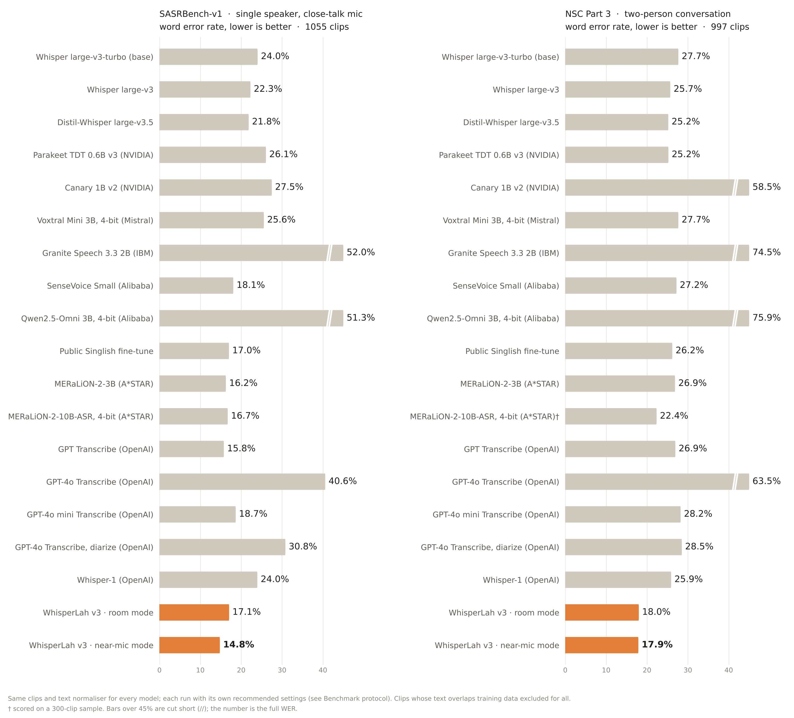
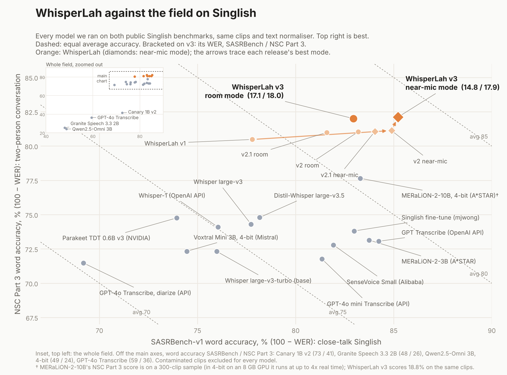

# WhisperLah: Singlish speech recognition

WhisperLah is a 56 MB LoRA adapter for `openai/whisper-large-v3-turbo`,
trained on open Singlish speech from IMDA's National Speech Corpus. This repo
holds the contamination-checked benchmark harness, training code and results
used to measure it against every Singlish model we could run, including
A*STAR's MERaLiON-2. **The trained weights are proprietary and are not
published here.**

Trained on one 8 GB laptop GPU (RTX 4060) in about 31 hours of GPU time (v1 1.6 h, v2 4.5 h, v3 about 25 h).

**Lowest word error rate of every model tested on 5 of 7 Singlish test sets**, against 17 other models and API settings, including both public benchmarks: 14.8% on SASRBench-v1 (next best 15.8%, OpenAI's GPT Transcribe) and 18.0% on NSC two-person conversation (next best 25.2%, Distil-Whisper large-v3.5; MERaLiON-2-10B-ASR scores 22.4% on a sample of 299 clips, where v3 scores 18.8%). Behind on NSC Part 1 (6.0% vs 4.8% for MERaLiON-2-3B) and NSC Part 2 (21.7% vs 6.6% for MERaLiON-2-3B): read-speech sets whose prompt sentences recur in the training data (see Benchmark protocol). It also writes down the Singlish discourse particles (lah, leh, lor …) that other models drop: 76% of them on NSC Part 3, against 50% for the next best (OpenAI's GPT Transcribe) and 10% or less for 8 of the 17 others.



Every model we have scored on both public Singlish benchmarks, with each
WhisperLah release (`scripts/chart_sota.py`):



## Results

Word error rate, %, lower is better. Every model is scored on the same clips
with the same text normaliser. Bold is the best score on each test set.

| Model | SASRBench-v1<br>1055 clips | NSC P3 conversation<br>997 clips | NSC P1 read<br>484 clips | NSC P2 read, local names<br>490 clips | NSC P4 conversation<br>300 clips | NSC P5 conversation<br>300 clips | NSC P6 conversation<br>300 clips | AMI meetings, headset mic (English)<br>11653 clips | AMI meetings, table mic (English)<br>11653 clips | LibriSpeech clean (English)<br>2620 clips | LibriSpeech other (English)<br>2939 clips |
|---|---|---|---|---|---|---|---|---|---|---|---|
| Whisper large-v3-turbo (OpenAI, the base model) | 24.0 | 27.7 | 7.5 | 33.6 | 43.0 | 21.5 | 17.6 | 14.9 | 34.1 | **1.9** | **3.9** |
| Whisper large-v3 (OpenAI) | 22.3 | 25.7 | 6.7 | 31.0 | 42.6 | 20.6 | 16.6 | TBD | TBD | TBD | TBD |
| Distil-Whisper large-v3.5 | 21.8 | 25.2 | 7.5 | 34.6 | 43.7 | 17.5 | 15.4 | TBD | TBD | TBD | TBD |
| Parakeet TDT 0.6B v3 (NVIDIA) | 26.1 | 25.2 | 5.3 | 34.9 | 42.7 | 16.3 | 13.5 | TBD | TBD | TBD | TBD |
| Canary 1B v2 (NVIDIA) | 27.5 | 58.5 | 5.2 | 36.9 | TBD | TBD | TBD | TBD | TBD | TBD | TBD |
| Voxtral Mini 3B (Mistral, 4-bit) | 25.6 | 27.7 | 6.8 | 35.0 | 55.3 | 18.3 | 16.0 | TBD | TBD | TBD | TBD |
| Granite Speech 3.3 2B (IBM) | 52.0 | 74.5 | 9.3 | 40.1 | 129.8 | 26.4 | 18.5 | TBD | TBD | TBD | TBD |
| SenseVoice Small (Alibaba) | 18.1 | 27.2 | 5.5 | 10.4 | 47.2 | 18.1 | 15.6 | TBD | TBD | TBD | TBD |
| Qwen2.5-Omni 3B (Alibaba, 4-bit) | 51.3 | 75.9 | 16.3 | 95.8 | 132.4 | 40.0 | 39.4 | TBD | TBD | TBD | TBD |
| Public Singlish fine-tune (mjwong) | 17.0 | 26.2 | 8.9 | 31.0 | 41.2 | 18.8 | 15.2 | TBD | TBD | TBD | TBD |
| MERaLiON-2-3B (A*STAR) | 16.2 | 26.9 | **4.8** | **6.6** | 40.8 | 19.3 | 14.9 | TBD | TBD | TBD | TBD |
| MERaLiON-2-10B-ASR (A*STAR, 4-bit) | 16.7 | 22.4† | TBD | TBD | TBD | TBD | TBD | TBD | TBD | TBD | TBD |
| GPT Transcribe (OpenAI API) | 15.8 | 26.9 | 5.3 | 29.2 | 34.3 | 16.9 | 14.8 | TBD | TBD | TBD | TBD |
| GPT-4o Transcribe (OpenAI API) | 40.6 | 63.5 | 7.5 | 35.3 | 69.1 | 49.5 | 40.2 | TBD | TBD | TBD | TBD |
| GPT-4o mini Transcribe (OpenAI API) | 18.7 | 28.2 | 7.1 | 39.2 | 43.6 | 22.1 | 17.6 | TBD | TBD | TBD | TBD |
| GPT-4o Transcribe, diarize (OpenAI API) | 30.8 | 28.5 | 8.3 | 33.6 | 50.3 | 19.0 | 16.0 | TBD | TBD | TBD | TBD |
| Whisper-1 (OpenAI API) | 24.0 | 25.9 | TBD | TBD | TBD | TBD | TBD | TBD | TBD | TBD | TBD |
| WhisperLah v1 | 22.2 | 19.5 | TBD | TBD | TBD | TBD | TBD | TBD | TBD | TBD | TBD |
| WhisperLah v2 · room mode | 16.8 | 19.0 | 6.2 | 23.6 | 29.5 | 14.3 | 11.1 | 11.3 | 33.0 | 2.2 | 4.7 |
| WhisperLah v2 · near-mic mode | 15.1 | 18.9 | TBD | TBD | TBD | TBD | TBD | TBD | TBD | TBD | TBD |
| WhisperLah v2.1 · room mode | 18.4 | 19.0 | 6.2 | 23.5 | 29.9 | **13.7** | 10.9 | TBD | TBD | TBD | TBD |
| WhisperLah v2.1 · near-mic mode | 16.0 | 18.9 | TBD | TBD | TBD | TBD | TBD | TBD | TBD | TBD | TBD |
| **WhisperLah v3** · room mode | 17.1 | 18.0 | 6.0 | 21.7 | **27.8** | 14.3 | **10.7** | **9.2** | **24.9** | **1.9** | 4.5 |
| **WhisperLah v3** · near-mic mode | **14.8** | **17.9** | TBD | TBD | TBD | TBD | TBD | TBD | TBD | TBD | TBD |

Singapore discourse particles caught (lah, leh, lor, meh, sia, hor, mah, liao …), share of those in the reference:

| Model | SASRBench-v1 | NSC P3 conversation |
|---|---|---|
| Whisper large-v3-turbo (OpenAI, the base model) | 5% | 10% |
| Whisper large-v3 (OpenAI) | 18% | 36% |
| Distil-Whisper large-v3.5 | 3% | 3% |
| Parakeet TDT 0.6B v3 (NVIDIA) | 8% | 10% |
| Canary 1B v2 (NVIDIA) | 3% | 2% |
| Voxtral Mini 3B (Mistral, 4-bit) | 10% | 18% |
| Granite Speech 3.3 2B (IBM) | 2% | 2% |
| SenseVoice Small (Alibaba) | 30% | 14% |
| Qwen2.5-Omni 3B (Alibaba, 4-bit) | 20% | 11% |
| Public Singlish fine-tune (mjwong) | 9% | 6% |
| MERaLiON-2-3B (A*STAR) | 6% | 3% |
| MERaLiON-2-10B-ASR (A*STAR, 4-bit) | 6% | 2% |
| GPT Transcribe (OpenAI API) | 48% | 50% |
| GPT-4o Transcribe (OpenAI API) | 24% | 9% |
| GPT-4o mini Transcribe (OpenAI API) | 34% | 32% |
| GPT-4o Transcribe, diarize (OpenAI API) | 14% | 16% |
| Whisper-1 (OpenAI API) | 19% | 28% |
| WhisperLah v1 | 69% | 74% |
| WhisperLah v2 · room mode | 69% | 74% |
| WhisperLah v2 · near-mic mode | 70% | 72% |
| WhisperLah v2.1 · room mode | 72% | 73% |
| WhisperLah v2.1 · near-mic mode | 70% | 72% |
| **WhisperLah v3** · room mode | 72% | 76% |
| **WhisperLah v3** · near-mic mode | 70% | 75% |

TBD means not tested yet; those cells are left for a later round. So far
the English sets (AMI, LibriSpeech) are regression checks, run only for base
Whisper and WhisperLah. Near-mic mode and WhisperLah v1 are scored on the two
public benchmarks only. Whisper-1 and MERaLiON-2-10B-ASR were also run on
those two only, to save API cost and because the 10B runs at up to 4x real
time on the 8 GB GPU. Canary 1B v2's Parts 4 to 6 were stopped (see Other
notes).

**OpenAI API settings.** Each OpenAI model is shown at the setting that
scored better for it. GPT Transcribe and GPT-4o Transcribe use
`chunking_strategy="auto"`: without it GPT-4o Transcribe stops early and drops
most of each clip (58.4% on SASRBench), and even with it, deletions make up
most of its errors. GPT-4o mini Transcribe is shown without chunking, which is
better for it on every set (with chunking: 26.8% on SASRBench). Whisper-1 gets
`language="en"`, as every local Whisper run does; left to auto-detect, it
translated the Singlish into Malay (97% on SASRBench). Whisper-1 was scored on
the two public benchmarks only. The other runs are kept in `results/` as
`-nochunk` and `-autolang`. GPT-4o Transcribe diarize, like WhisperLah v1,
writes down the background speaker on SASRBench, which that benchmark counts
as insertions. OpenAI API cost for all of this: about US$48.

**Other notes.** Canary 1B v2 and Granite Speech 3.3 2B fall into repetition
loops on long conversation clips (Canary writes up to 1,000 words for one
clip). That is most of their NSC Part 3 error (58.5% and 74.5%) and Granite's
129.8% on Part 4; Canary's Parts 4 to 6 were stopped for that reason.
Qwen2.5-Omni 3B is a chat model and often answers the speaker instead of
transcribing them ("I have never received or shared a lobang so I can't
really answer that question", on NSC Part 3). It does this on about one in
seven of NSC Part 2's short read questions (95.8%), and it loops on the
Mandarin code-switched clips of Part 4 (132.4%). Its outputs are scored as
they are, like every other model's.
SenseVoice Small's 10.4% on NSC Part 2 is far below every other model except
MERaLiON-2-3B, which suggests it, too, was trained on NSC read speech (see
Benchmark protocol). † MERaLiON-2-10B-ASR is scored on a fixed 300-clip
sample of NSC Part 3 (299 after the contamination filter): in 4-bit on the
8 GB GPU it runs at up to 4x real time. On those same clips WhisperLah v3
scores 18.8%, against its 22.4%.

Full numbers, including substitutions/deletions/insertions per model:
`results/table.json`. Every hypothesis for every clip: `results/<set>__<model>.jsonl`.

## Where WhisperLah v3 is best, and where it is not

Lowest word error rate of every model we ran on the same clips (release adapter v3, best of room and near-mic mode; v2 shown for reference):

| Test set | WhisperLah v3 | v2 | Best other model | Result |
|---|---|---|---|---|
| SASRBench-v1, close-talk | **14.8** | 15.1 | 15.8 (GPT Transcribe) | win |
| NSC Part 3, two-person conversation | **17.9** | 18.9 | 25.2 (Distil-Whisper large-v3.5)† | win |
| NSC Part 4, conversation | **27.8** | 29.5 | 34.3 (GPT Transcribe) | win |
| NSC Part 5, conversation | 14.3 | 14.3 | 16.3 (Parakeet TDT 0.6B v3) | win (v2.1's 13.7 is lower still) |
| NSC Part 6, conversation | **10.7** | 11.1 | 13.5 (Parakeet TDT 0.6B v3) | win |
| AMI meetings, headset mic (English) | **9.2** | 11.3 | 14.9 (Whisper large-v3-turbo) | win, vs Whisper only |
| AMI meetings, table mic (English) | **24.9** | 33.0 | 34.1 (Whisper large-v3-turbo) | win, vs Whisper only |
| NSC Part 1, read speech | 6.0 | 6.2 | 4.8 (MERaLiON-2-3B) | behind |
| NSC Part 2, read speech, local names | 21.7 | 23.6 | 6.6 (MERaLiON-2-3B) | behind |
| LibriSpeech clean (English) | 1.9 | 2.2 | 1.9 (Whisper large-v3-turbo) | level with base |
| LibriSpeech other (English) | 4.5 | 4.7 | 3.9 (Whisper large-v3-turbo) | 0.6 pt behind base |

† MERaLiON-2-10B-ASR was run on a 300-clip sample of Part 3 only: 22.4 there,
against 18.8 for v3 on the same clips.

Five of the seven Singlish test sets, including both public benchmarks, are
won outright by a WhisperLah model, against every open model and OpenAI API
we could run, and v3 improves on v2 on six of the seven (Part 5 is flat). The
two losses are read-speech sets whose prompt sentences recur in the training
data (see Benchmark protocol), so we are not chasing them. No single outside
model comes closest everywhere: OpenAI's GPT Transcribe is nearest on
SASRBench (1.0 pt behind v3's near-mic mode) and Part 4 (6.5 pt), NVIDIA's
Parakeet on Parts 5 and 6 (2.0 and 2.7 pt), and MERaLiON-2-10B-ASR on Part 3
(3.6 pt, on its 300-clip sample). The largest
v3 gain is on far-field English meetings: AMI table mic falls from 33.0 to
24.9, from v3's AMI training data. On English meetings, only base Whisper has
been measured so far; other English models have not been run, so those rows
do not claim a leaderboard position.

**Release gate.** Set before scoring: v3 must improve NSC Part 3, be no more
than 0.5 pt worse than v2 on any set, and stay within 0.5 pt of base Whisper
on LibriSpeech. v3 passes every Singlish and AMI condition and LibriSpeech
clean, and misses LibriSpeech other by 0.1 pt (4.53 against a 4.41 limit),
while still improving on v2's 4.68 there. We release v3 as the default and
report the miss rather than move the gate.

## Next benchmarks to beat

Chosen by what a meeting or coffee-chat product needs, and by what one 8 GB
laptop GPU can reach (full reasoning in the repo's planning notes).

| Target | Today | Aim | Status |
|---|---|---|---|
| **KopiChat**, our own café-chat set (phone on a table, two speakers; recording protocol in `scripts/kopichat/README.md`) | not recorded yet | lowest of every model and the OpenAI API | recordings and consent forms needed |
| **NSC Parts 3 to 6**, further | 17.9 / 27.8 / 14.3 / 10.7 (v3) | lower again, especially Part 5 | v3 done: 3 of 4 improved, Part 5 flat |
| **AMI table-mic meetings** (far-field) | 24.9 (v3) | well below Whisper's 34.1 | done with v3: 9.2 pt below Whisper |
| **SASRBench and NSC Part 3 vs MERaLiON-2-10B** | SASRBench 14.8 (v3 near-mic) vs 16.7; Part 3 18.8 vs 22.4 on 300 clips | confirm the win against the 10B | done in 4-bit (about 23 GPU-hours on 8 GB); Part 3 on a 300-clip sample |
| **English regression gate** (LibriSpeech) | clean level with base, other 0.6 pt behind (v3) | within 0.5 pt of base | clean met; other missed by 0.1 pt |
| OpenAI and other closed APIs | all four OpenAI transcription models on all 7 Singlish sets (Whisper-1 on 2) | KopiChat; other vendors | OpenAI done: best is GPT Transcribe, behind v3 on 6 of 7 sets |
| Other open ASR models | Parakeet, Canary, Voxtral, Granite, SenseVoice, Qwen2.5-Omni, Distil-Whisper | ahead of every open model on conversation | done: v3 ahead on all five conversational sets; best new model is SenseVoice Small |

Not targeted: NSC Parts 1 and 2 (read speech), and large English leaderboards
(Earnings-22, GigaSpeech, and similar). Those are decided by 10B-parameter
models trained on 100k hours, and they do not match the product.

## Two modes: room and near-mic

The two public Singlish benchmarks disagree about *whose* words count.

- **NSC conversation tests** label everyone in the room.
- **SASRBench** labels only the person wearing the close-talk mic, even
  though the other speaker is audible in the recording.

A model that writes down the background speaker is right for meeting notes and
"wrong" for SASRBench. WhisperLah v1 did exactly that: its SASRBench errors
were mostly the other person's real words, scored as insertions. The public
Singlish fine-tune learned the opposite convention and drops the second speaker
on NSC conversation.

WhisperLah v2 and v3 learn both, switched by a Whisper text prompt:

| Mode | How | Use it for |
|---|---|---|
| **Room** (default) | no prompt | meetings: transcribe everyone |
| **Near-mic** | prompt `Near speaker only.` | a lapel or headset mic: transcribe the wearer |

Near-mic mode is taught with synthetic data: single-speaker Singlish read
speech with a random stretch of NSC Part 3 conversation mixed in 6–20 dB
quieter, labelled with the near speaker's words only. The prompt tokens are
masked out of the loss. Both modes are reported on every test, so the choice is
visible rather than tuned per benchmark.

## Use it

```python
import torch
from peft import PeftModel
from transformers import WhisperForConditionalGeneration, WhisperProcessor

processor = WhisperProcessor.from_pretrained("openai/whisper-large-v3-turbo")
model = WhisperForConditionalGeneration.from_pretrained(
    "openai/whisper-large-v3-turbo", torch_dtype=torch.float16).to("cuda")
# the WhisperLah weights are not distributed in this repo
model = PeftModel.from_pretrained(model, "path/to/your/adapter").merge_and_unload()

feats = processor(audio_16k, sampling_rate=16000, return_tensors="pt").input_features.to("cuda", torch.float16)
kw = dict(language="en", task="transcribe",
          temperature=(0.0, 0.2, 0.4, 0.6, 0.8, 1.0), compression_ratio_threshold=1.35)

room = model.generate(feats, **kw)                                   # everyone in the room
near = model.generate(feats, **kw, max_new_tokens=438,               # only the near speaker
                      prompt_ids=processor.get_prompt_ids("Near speaker only.", return_tensors="pt").to("cuda"))
print(processor.batch_decode(room, skip_special_tokens=True)[0])
```

Clips up to 30 s; split longer audio first. The adapter needs the base model
`openai/whisper-large-v3-turbo` (MIT). The snippet shows how an adapter is loaded; the WhisperLah adapters themselves are not in this repo.

## How v3 was built

v3 continues from v2 with about 5.7 times more training clips, adding the rest
of the NSC conversation shards plus English meeting and read speech so the
adapter holds up off Singlish:

| Source | Clips |
|---|---|
| NSC Part 1 / Part 2 (read) | 2,929 / 37,434 |
| NSC Part 3 (two-person conversation) | 38,283 |
| NSC Parts 4 / 5 / 6 (conversation) | 9,627 / 8,108 / 9,034 |
| Near-mic mixtures (Parts 1–2 over quiet Part 3) | 6,332 |
| AMI meetings, headset / table mic (English) | 20,612 / 31,467 |
| LibriSpeech (English, read) | 10,194 |

174,020 clips in all. Same adapter shape as v2 (LoRA r=32, α=64, encoder and
decoder), warm-started from v2 final, SpecAugment on, AdamW lr 1.5e-4 cosine,
batch 4 × 4 accumulation, 7,000 steps (0.67 epoch), checkpoints every 1,000
steps probed on 300 NSC Part 3 and SASRBench clips. The run was interrupted
after step 5,350 and resumed from the step-5,000 checkpoint with the schedule
position restored (`train_lora.py --start_step`). About 25 h on the same
RTX 4060 at 3.2 GB peak, roughly 12 s per step. Commands: `scripts/run_v3.sh`,
`scripts/run_v3_resume.sh`, `scripts/run_v3_evals.sh`.

## How v2 was built

### Data: all six parts of the National Speech Corpus

| Source (IMDA NSC, via A*STAR MNSC) | What it is | Clips |
|---|---|---|
| Part 1 | read sentences | 2,929 |
| Part 2 | read sentences with Singapore names and terms | 3,403 |
| Part 3 | two-person free conversation (v1 slice + 8 new shards) | 11,257 |
| Part 4 | conversation | 2,265 |
| Part 5 | conversation | 1,871 |
| Part 6 | conversation | 2,582 |
| Near-mic mixtures | Parts 1–2 speech over quiet Part 3 conversation | 6,332 |

30,639 clips. Shards are taken evenly across each part for speaker spread.

### Training

| | |
|---|---|
| Base | `openai/whisper-large-v3-turbo` (809 M params), frozen, bf16 |
| Adapter | LoRA r=32, α=64 on q/k/v/out and fc1/fc2 of encoder **and** decoder: 27.9 M trainable params |
| Start | warm-started from v1 |
| Augmentation | SpecAugment, 5% time and 5% frequency masking (10-frame spans) |
| Schedule | AdamW, lr 2e-4, cosine with 70 warm-up steps, batch 16, 1,400 steps |
| Hardware | one RTX 4060 laptop GPU, 3.2 GB peak, 4.5 h (v1: a further 1.6 h) |

The encoder is adapted, not just the decoder: most of the gap on Singlish is
acoustic (accent, particles, fast overlapping turns), not vocabulary. Features
are stored unpadded and rebuilt at batch time, verified identical to Whisper's
own padding, which keeps 31 k clips in 8.5 GB.

## Benchmark protocol

| Test set | What it is | Clips used |
|---|---|---|
| SASRBench-v1 (`mjwong/SASRBench-v1`, MIT) | NSC Part 3 close-talk, single speaker, 4–20 s | fixed random 1,200 of 3,747 |
| NSC Part 3 test (MNSC) | two-person conversation, ≤30 s | all 1,000 |
| NSC Parts 1, 2 test (MNSC) | read speech | fixed random 500 each |
| NSC Parts 4, 5, 6 test (MNSC) | conversation | fixed random 300 each |

The MNSC test splits are the standardised held-out splits released by A*STAR's
MERaLiON team, the same ones AudioBench reports as "IMDA Part 1–6 ASR".

**Contamination.** Any test clip whose reference shares ≥30% of its 8-grams
with *any* WhisperLah training transcript is excluded from *every* model's
score (`prep_v2.py --check`, lists in `results/*_overlap_with_train.json`).
Removed: SASRBench 145 of the 1,200 sampled clips, NSC P1 / P2 / P3 / P6 a
handful each. One caveat we cannot remove: SASRBench is cut from NSC Part 3
recordings, and our check found 436 of its 3,747 clips inside just 20 of the
171 MNSC Part 3 training shards. A model trained on the full corpus has
therefore likely seen most of SASRBench's audio. That applies to MERaLiON-2,
which was trained on NSC-derived data at scale, and not to WhisperLah.

The read-speech tests (Parts 1 and 2) have a second, larger version of the
same issue. Each is about 1,000 prompt sentences, each read by three speakers,
and the same prompts recur across the training split: a single one of our
training shards already contains the text of 2.1% (Part 2) to 3.7% (Part 1) of
the test clips. Across the 727–771 training shards of each part, essentially
every test sentence appears in training text. Clips overlapping *our* training
text are excluded, but a model trained on the full split, as MERaLiON-2 likely
was, has read every test sentence. Its lead on Parts 1 and 2 should be read
with that in mind; the conversational tests (Parts 3–6, SASRBench) have no
such recurring prompts.

**Scoring.** `jiwer` WER after one normaliser applied identically to every
reference and hypothesis (`scripts/common.py`): NSC markup removed
(`<Speaker1>:`, `(uh)`, `(ppl)`, `**`, `#…#`, `~`), Singlish particles kept
(`[lah]` → `lah`), then Whisper's `EnglishTextNormalizer`, spelled acronyms
joined, `yeah/yah` → `ya`, `ok` → `okay`. Numbers are comparable within this
table, not with leaderboards that normalise differently.

**Decoding.** Every Whisper-based model: greedy with Whisper's standard
temperature fallback when an output's compression ratio exceeds 1.35, which
catches repetition loops ("ya, ya, ya, …"). MERaLiON-2-3B and -10B-ASR: the
authors' transcription prompt and settings, greedy, up to 320 new tokens; the
10B in 4-bit NF4 (`eval_meralion.py --load-in-4bit`) to fit 8 GB. Parakeet
TDT 0.6B v3 and Canary 1B v2: the ONNX exports through `onnx-asr`
(`eval_onnxasr.py`). Voxtral Mini 3B: 4-bit NF4 through the Transformers
transcription request (`eval_voxtral.py`). Granite Speech 3.3 2B: the model
card's transcription prompt (`eval_granite.py`). SenseVoice Small: `funasr`,
English, inverse text normalisation on, its language, emotion and event tags
removed (`eval_sensevoice.py`). Qwen2.5-Omni 3B: the text-only "thinker" with
its language model in 4-bit NF4 (about 9 GB in bf16), the model card's system
prompt and English transcription instruction, stopping at the end-of-turn
token (`eval_qwen_omni.py`). The chat-style models (Voxtral, Granite,
Qwen2.5-Omni) get up to 500 new tokens. Every model is run in English with its
own default greedy decoding and no prompt tricks; OpenAI settings are above.

## Reproduce

```bash
uv venv --python 3.12 .venv
uv pip install --python .venv/Scripts/python.exe torch==2.5.1 torchaudio==2.5.1 --index-url https://download.pytorch.org/whl/cu121
uv pip install --python .venv/Scripts/python.exe transformers==4.46.3 peft==0.13.2 datasets==3.1.0 accelerate==1.1.1 jiwer soundfile librosa huggingface_hub==0.26.2 pyarrow tqdm matplotlib
# MERaLiON-2 pins transformers 4.50.1, so it gets its own environment
uv venv --python 3.12 .venv-meralion
uv pip install --python .venv-meralion/Scripts/python.exe torch==2.5.1 --index-url https://download.pytorch.org/whl/cu121
uv pip install --python .venv-meralion/Scripts/python.exe transformers==4.50.1 accelerate librosa soundfile pyarrow tqdm hf_xet
# the other open models (Parakeet, Canary, Voxtral, Granite, SenseVoice, Qwen2.5-Omni) share a third one.
# Keep onnxruntime-gpu at 1.22.0: newer builds need CUDA 13 and silently fall back to the CPU without it.
uv venv --python 3.12 .venv-bench
uv pip install --python .venv-bench/Scripts/python.exe torch==2.7.1 torchaudio==2.7.1 torchvision==0.22.1 --index-url https://download.pytorch.org/whl/cu126
uv pip install --python .venv-bench/Scripts/python.exe transformers==4.57.6 accelerate==1.15.0 bitsandbytes==0.50.2 onnx-asr==0.12.0 onnxruntime-gpu==1.22.0 funasr==1.4.16 mistral-common==1.12.0 librosa==1.0.0 soundfile==0.14.0 pyarrow tqdm

python scripts/download.py && python scripts/download_v2.py
cd scripts
python prep_train.py                                     # v1 features (Part 3 slice)
python train_lora.py --steps 500 --save_every 125 --name lora-r32
python prep_v2.py && python prep_near.py && python prep_v2.py --check
python train_lora.py --steps 1400 --data v1,v2 --init ../runs/lora-r32/final --lr 2e-4 --specaug --save_every 200 --name v2
bash run_v2_evals_b.sh                                   # every model, every test set
# the newer open models, one set at a time (clip limits in Benchmark protocol), e.g.
../.venv-bench/Scripts/python.exe eval_sensevoice.py --set sasrbench --limit 1200   # also eval_onnxasr, eval_voxtral, eval_granite, eval_qwen_omni
python report.py && python table_md.py && python chart_v2.py whisperlah-v3 ../results/whisperlah_v3_chart.png && python chart_sota.py
```

## Limits

- One training run per version, one seed. v3 saw 0.67 epoch of 174 k clips.
- v3 is 0.6 pt behind base Whisper on LibriSpeech other, 0.1 pt outside our
  own release gate.
- Whisper does not label speakers. In Rapport, WhisperLah replaces only the
  transcription step; speaker attribution still needs a diarizer.
- NSC is studio-quiet close-mic audio. Café noise is not covered by any of
  these benchmarks.

## History

- **v1**: LoRA on 52 h of NSC Part 3 conversation (500 steps). NSC P3 19.5%,
  SASRBench 22.2%; its SASRBench errors were mostly the background speaker,
  which led to v2's near-mic mode.
- **v2** (release until v3): all six NSC parts, near-mic mode, SpecAugment, warm
  start from v1. 1,400 steps reached 73% of the 30.6 k clips.
- **v2.1** (not released as default): 300 more steps from v2 on the 8.1 k clips
  v2 never reached, restarting the learning-rate schedule at 1e-4. The rule set
  before scoring was "replace v2 only if the 7-set average improves". It did
  not: 17.00% against v2's 16.96%, better on Parts 1, 2, 5, 6 and worse on
  SASRBench, Parts 3 and 4. Its row stays in the table.
- **v3** (the release): 174 k clips including more NSC conversation, AMI
  meetings and LibriSpeech; 7,000 steps warm-started from v2. Better than v2
  on six of seven Singlish sets and both AMI sets (table mic 33.0 → 24.9);
  near-mic SASRBench 14.8, NSC Part 3 17.9. Misses the LibriSpeech-other gate
  by 0.1 pt.

## Data and attribution

Training and test audio come from IMDA's National Speech Corpus, through
A*STAR MERaLiON's Multitask National Speech Corpus release on Hugging Face.
Contains information from the National Speech Corpus accessed from IMDA, made
available under the terms of the Singapore Open Data Licence version 1.0.
SASRBench-v1 (`mjwong/SASRBench-v1`) is MIT-licensed. MERaLiON-2-3B and
MERaLiON-2-10B-ASR are used for evaluation only, under the MERaLiON Public
Licence; every other outside model is used for evaluation only, under its own
licence. The per-clip result
files include reference transcripts so every number can be re-scored; no
audio is redistributed here.
